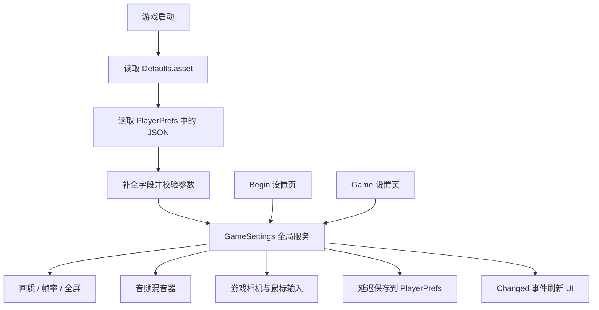

# 全局设置系统实现说明

本系统已经接入开始场景 `Begin` 和游戏场景 `Game`。两处设置页使用同一个 UI 预制体，并读写同一个全局设置服务。玩家在开始菜单调整后，进入游戏会继续使用这些设置；退出并重新启动后，也会读取上次保存的偏好。

界面沿用项目原来的英文菜单和西部风格标题，分为 **GRAPHICS（画面）、AUDIO（声音）、CONTROLS（操作）** 三页。以下说明对应当前实际实现。

## 1. 使用方法

- 开始场景：点击原来的 `Setting` 按钮。
- 游戏场景：按 `Esc` 暂停，再点击 `Setting`。
- 设置变化立即应用，停止操作约 0.5 秒后自动保存；关闭设置时也会保存。
- 画面页内容较多，可以使用滚轮或右侧滚动条查看下面的选项。
- `BACK` 或 `Esc` 关闭设置。游戏内会先返回暂停菜单，点击 `Resume` 才恢复游戏。
- `RESTORE DEFAULTS` 第一次点击变为 `CONFIRM RESET`，4 秒内再次点击才恢复所有默认值。

两个场景的原设置面板都位于：

```text
Canvas
└─ Setting Panel                 ← 原有的 SettingsAnimation
   └─ UI                         ← 共享预制体的实例
      └─ Frame
         ├─ Tab 0 / 1 / 2
         ├─ Body
         │  └─ Settings Scroll
         │     └─ Viewport
         │        ├─ Graphics Page
         │        ├─ Audio Page
         │        └─ Controls Page
         ├─ Restore Defaults
         └─ Back
```

## 2. 已实现的 16 项设置

| 页面 | 界面名称              | 范围或选项                        | 实际控制                                     |
| ---- | --------------------- | --------------------------------- | -------------------------------------------- |
| 画面 | Quality preset        | 项目现有的 6 个画质等级           | `QualitySettings.SetQualityLevel`          |
| 画面 | LOD detail            | 0.25–4.00 倍                     | `QualitySettings.lodBias`                  |
| 画面 | Texture detail        | 原始 / 半分辨率 / 四分之一分辨率  | `QualitySettings.globalTextureMipmapLimit` |
| 画面 | Shadows               | 关闭 / 硬阴影 / 软阴影            | `QualitySettings.shadows`                  |
| 画面 | Shadow distance       | 10–150 米                        | `QualitySettings.shadowDistance`           |
| 画面 | Anti-aliasing         | 关闭 / 2x / 4x / 8x MSAA          | `QualitySettings.antiAliasing`             |
| 画面 | VSync                 | 开 / 关                           | `QualitySettings.vSyncCount`               |
| 画面 | Frame rate limit      | 30 / 60 / 90 / 120 / 144 / 不限制 | `Application.targetFrameRate`              |
| 画面 | Borderless fullscreen | 开 / 关                           | `Screen.fullScreenMode`                    |
| 声音 | Master volume         | 0–100%                           | 混音器总线`MasterVolume`                   |
| 声音 | Music volume          | 0–100%                           | 混音器音乐总线`MusicVolume`                |
| 声音 | Effects volume        | 0–100%                           | 混音器音效总线`EffectsVolume`              |
| 操作 | Mouse sensitivity     | 0.25–3.00 倍                     | 原有鼠标速度乘数                             |
| 操作 | Invert vertical look  | 开 / 关                           | 鼠标 Y 输入方向                              |
| 操作 | Field of view         | 45–90 度                         | 游戏相机`Camera.fieldOfView`               |
| 操作 | Show frame rate       | 开 / 关                           | 屏幕右上角 FPS 计数                          |

### 当前默认值

默认值保存在 `Resources/GameSettings/Defaults.asset`，运行时读取副本，不会因玩家的调整而改写该资源。

安装时采用项目当前默认画质：

- 画质 `Ultra`，LOD 4.00，阴影距离 35 米，软阴影。
- 原始纹理分辨率、4x MSAA、垂直同步开启。
- 帧率上限记忆值为 60；垂直同步开启时由屏幕刷新率接管。
- 无边框全屏开启。
- 总音量、音乐、音效均为 100%。
- 鼠标灵敏度 1.00 倍，Y 轴不反转，FOV 60 度，FPS 显示关闭。

开发者可以在 Inspector 中编辑 `Defaults.asset` 的 `Values`。已有玩家存档仍优先使用保存的值；点击恢复默认值才会使用修改后的默认配置。

## 3. 文件与职责

主目录：`Assets/Scripts/My Scripts/SettingsSystem`。

| 文件                                                                                                                                          | 职责                                        |
| --------------------------------------------------------------------------------------------------------------------------------------------- | ------------------------------------------- |
| [GameSettingsData.cs](</D:/WorkSpace/Unity-Project/Game-Project/Assets/Scripts/My Scripts/SettingsSystem/Runtime/GameSettingsData.cs>)         | 设置字段、枚举、JSON 加载、数值校验         |
| [GameSettingsDefaults.cs](</D:/WorkSpace/Unity-Project/Game-Project/Assets/Scripts/My Scripts/SettingsSystem/Runtime/GameSettingsDefaults.cs>) | 默认配置资源的类型                          |
| [GameSettings.cs](</D:/WorkSpace/Unity-Project/Game-Project/Assets/Scripts/My Scripts/SettingsSystem/Runtime/GameSettings.cs>)                 | 全局服务、应用参数、保存、FPS 显示          |
| [SettingsPanelView.cs](</D:/WorkSpace/Unity-Project/Game-Project/Assets/Scripts/My Scripts/SettingsSystem/Runtime/SettingsPanelView.cs>)       | 三页 UI、控件事件、刷新、恢复默认值确认     |
| [SettingsCamera.cs](</D:/WorkSpace/Unity-Project/Game-Project/Assets/Scripts/My Scripts/SettingsSystem/Runtime/SettingsCamera.cs>)             | 将 FOV 应用到指定的游戏相机                 |
| [SettingsUISetup.cs](</D:/WorkSpace/Unity-Project/Game-Project/Assets/Scripts/My Scripts/SettingsSystem/Editor/SettingsUISetup.cs>)            | 在编辑器中创建共享 UI、安装到场景、配置音源 |
| [SettingsDataTests.cs](</D:/WorkSpace/Unity-Project/Game-Project/Assets/Scripts/My Scripts/SettingsSystem/Tests/SettingsDataTests.cs>)         | 存档和参数处理的自动测试                    |
| `Resources/GameSettings/Defaults.asset`                                                                                                     | 固定默认值                                  |
| `Resources/GameSettings/GlobalAudio.mixer`                                                                                                  | Master、Music、SFX 三个音频总线             |
| `Assets/UI/Settings/GlobalSettingsPanel.prefab`                                                                                             | 两个场景共享的 UI                           |

现有脚本的接入点：

- `UI/Setting Panel.cs` 中的 `SettingsAnimation`：保留原组件和引用，完善打开、关闭及返回暂停菜单的流程。
- `UI/UI Manager.cs`：游戏内按 Esc 时，优先处理设置页；恢复游戏前清理仍打开的设置。
- `Player/Player Pivot.cs`：将设置乘数和反转选项应用到原鼠标旋转代码。

新运行时代码使用独立程序集 `Western.Settings`，测试放在 `Western.Settings.Tests`。编辑器生成器位于 `Editor` 文件夹，不会进入游戏构建。

## 4. 为什么两个场景能够共用参数

`GameSettings` 在加载第一个场景前，通过 `RuntimeInitializeOnLoadMethod(BeforeSceneLoad)` 自动创建。



这个对象调用 `DontDestroyOnLoad`，切换场景时不会销毁；同时有重复实例保护，因此不会出现两份设置互相覆盖。

即使直接从 Unity 的 `Game` 场景进入 Play Mode，也会自动初始化，不依赖先经过开始菜单。场景内的 UI 只负责显示与输入，不负责保存另一套配置。

运行时的读取示例：

```csharp
using Western.Settings;

float lod = GameSettings.Instance.Data.lodBias;
bool invert = GameSettings.Instance.Data.invertY;
```

修改参数要调用服务方法，使应用、通知、保存流程一起执行：

```csharp
GameSettings.Instance.SetValue(SettingKey.LodBias, 1.5f);
GameSettings.Instance.SetValue(SettingKey.MasterVolume, 0.8f);
GameSettings.Instance.SetValue(SettingKey.ShowFps, 1f);
```

不要直接写 `Data` 字段；直接写字段不会触发这些流程。

## 5. UI 怎样连接到参数

`SettingsPanelView` 保存一组 `SettingsWidget`。每个 Widget 包含：

- 一个 `SettingKey`，标识它控制的参数。
- 对应的 `Slider`、`TMP_Dropdown` 或 `Toggle`。
- 显示数值与提示的文字，以及控制可交互状态的 `CanvasGroup`。
- 下拉框需要时使用的 `optionValues`，把下拉框索引映射成实际数值。

例如，帧率下拉框索引 3 对应 120 FPS；“不限制”对应 -1。抗锯齿索引 0、1、2、3 分别映射为 0、2、4、8。

事件流程：

```text
玩家拖动滑块
→ Slider.onValueChanged
→ GameSettings.SetValue
→ 校验并应用到 Unity
→ Changed 事件
→ UI 刷新数值和控件状态
→ 0.5 秒后保存
```

UI 刷新使用 `SetValueWithoutNotify`、`SetIsOnWithoutNotify`，避免“刷新控件又触发修改”的循环。

控件值同时显示单位，例如 LOD 的 `2.25x`、阴影距离的 `75 m`、音量的 `35%`。

## 6. 画质、LOD 与帧率的原理

### 6.1 画质预设

画质列表直接来自 `QualitySettings.names`，对应项目的 Very Low、Low、Medium、High、Very High、Ultra。

选择预设时，先执行 `QualitySettings.SetQualityLevel`，再读取该预设的 LOD、阴影、纹理及抗锯齿参数，同步到设置数据和 UI。

之后仍然可以单独微调这些参数。选择另一个预设会重新载入其画质参数；声音、鼠标、FOV 和显示偏好保持独立。预设名称表示所选基础等级，单独微调时不会新增一个“Custom”等级。

### 6.2 LOD 偏移

界面里的 `LOD detail` 对应 `QualitySettings.lodBias`，它是倍率。

Unity 的 `LODGroup` 根据物体在屏幕上的相对大小决定使用哪个模型层级；`lodBias` 会影响这个判定：

- 更高的值：较远处仍保留精细模型，通常增加渲染开销。
- 更低的值：较早切换到简化模型，通常更有利于性能。
- 1.0 是标准倍率；4.0 表示更偏向保留细节。

这个设置直接影响已有 `LODGroup`，不会生成新模型，也不会修改轨道、建筑或火车的几何数据。没有配置 LODGroup 的物体不会因此获得 LOD 切换能力。

### 6.3 阴影、纹理和抗锯齿

阴影关闭时，距离滑块会变灰，但保留玩家选择的距离，重新开启阴影后可以继续使用。

纹理设置通过 mipmap 限制降低纹理分辨率。没有 mipmap 或设置为忽略此限制的纹理，仍遵循 Unity 对该纹理的处理方式。

抗锯齿使用内置渲染管线的 MSAA。当前项目使用 Built-in 管线；如果以后改为 URP/HDRP，需要按新管线重新接入画质相关 API。

### 6.4 垂直同步和帧率上限

垂直同步开启时：

```csharp
QualitySettings.vSyncCount = 1;
Application.targetFrameRate = -1;
```

此时刷新率由 VSync 接管，帧率上限控件禁用并显示原因。

垂直同步关闭时：

```csharp
QualitySettings.vSyncCount = 0;
Application.targetFrameRate = savedFrameLimit;
```

`-1` 表示不主动限制。实际帧率仍取决于硬件与场景负载，设置上限不会保证机器一定达到该帧率。

### 6.5 无边框全屏

开启时使用 `FullScreenMode.FullScreenWindow`，关闭时使用 `FullScreenMode.Windowed`。

该项在构建后的游戏中切换窗口模式。在 Unity Editor 中只保存偏好，不改变编辑器窗口；本次验证没有生成独立游戏构建，因此操作系统层面的窗口切换需要在构建版体验。

## 7. 总音量、音乐与音效怎样互相配合

音源现在按以下结构输出：

```text
菜单背景音乐 ─────────────── Music ──┐
                                    ├── Master ── 最终输出
脚步 / 枪声 / Dead Eye / UI ─ SFX ───┘
```

混音器资源为 `GlobalAudio.mixer`，公开了三个参数：

| 参数名            | 总线   |
| ----------------- | ------ |
| `MasterVolume`  | Master |
| `MusicVolume`   | Music  |
| `EffectsVolume` | SFX    |

UI 使用 0–1 的线性音量；混音器需要分贝，因此采用：

```text
dB = 20 × log10(volume)
```

对应关系：

- 100% → 0 dB。
- 50% → 约 -6.02 dB。
- 0% → -80 dB，作为近似静音，避免计算 log10(0)。

对于一个音效，最终线性音量可近似理解为：

```text
原 AudioSource 音量 × 音效音量 × 总音量
```

音乐则把“音效音量”替换为“音乐音量”。

### 为什么不反复修改 AudioSource.volume

项目的脚步声和 Dead Eye 脚本原本会设置或渐变 `AudioSource.volume`。全局设置如果也反复改这个字段，两套逻辑就会互相覆盖。

当前实现把全局音量放在混音器上，原音源仍保留自己的音量、距离衰减和淡入淡出。音量变化最终在输出阶段统一相乘。

`AudioMixer.SetFloat` 在全局服务的 `Start` 之后调用，避开 Unity 不建议在 Awake / OnEnable 中设置混音器参数的时机。混音器使用不受游戏时间缩放影响的更新时间模式。

### 当前音源覆盖范围

- 两个场景现有音源都已配置输出通道。
- 开始场景的 `RandomMusicPlayer` 对应音源使用 Music。
- 脚步、武器、Dead Eye、菜单按钮等使用 SFX。
- 两个场景依赖的 11 个含音源预制体已配置通道，包括 NPC 和武器，因此运行时实例化的这些对象也受控制。
- 游戏场景当前没有配置 `RandomMusicPlayer` 背景音乐。音乐滑块控制已有菜单音乐，以及后续明确接入 Music 总线的音乐源。

后续新增音源时，给 `AudioSource.Output` 指定 `GlobalAudio/Music` 或 `GlobalAudio/SFX`。通过新脚本临时 `AddComponent<AudioSource>()` 创建的音源，也需要在开始播放前赋予通道。系统没有每帧扫描并改写所有音源。

## 8. 鼠标与相机的接入

### 鼠标灵敏度

`Player Pivot.cs` 保留原先的 `_mouseSense`，使用以下乘法：

```csharp
float mouseSense = _mouseSense * preferences.mouseSensitivity;
```

默认乘数 1.0 保持原来的手感。横向输入使用新的 `mouseSense`；纵向输入也使用它，并保留原脚本已有的除以 5 的比例。

### 反转 Y 轴

根据 `invertY` 得到 +1 或 -1，乘到原纵向输入上。原有瞄准逻辑与俯仰角限制仍由 Pivot 控制。

### FOV

`SettingsCamera` 已添加到游戏场景的 `Pivot/Player Camera`。它在启用时立即读取设置，并订阅 `Changed` 事件：

```csharp
target.fieldOfView = settings.Data.fieldOfView;
```

开始场景的背景相机保持原有构图。玩家在开始菜单设置 FOV 后，进入游戏时由游戏相机自动应用。

若后续增加新的游戏视角相机，可给需要受设置控制的相机添加 `SettingsCamera`。小地图或固定展示相机通常不需要添加。

### FPS 显示

全局服务使用 `Time.unscaledDeltaTime` 累计帧数，每 0.5 秒更新一次显示值，通过 `OnGUI` 显示在右上角。它不依赖游戏时间，因此暂停时仍能统计实际渲染帧率。

## 9. 保存、读取与恢复默认值

存档使用一个独立的 PlayerPrefs 键：

```text
Western.Settings.v1
```

值是一段 `JsonUtility` 序列化的 JSON，包含当前版本号和全部参数。它属于本机游戏偏好，不会写入场景文件或默认值资源。

读取流程：

1. 复制 `Defaults.asset` 中的默认配置。
2. 用保存的 JSON 覆盖已有字段。
3. 未出现在 JSON 中的字段保留默认值，便于将来增加选项。
4. 损坏 JSON 或不支持的版本退回默认配置。
5. 校验范围，处理 NaN、Infinity、非法帧率和非法抗锯齿档位。

保存时机：

- 参数变化后，等待约 0.5 秒无新变化再保存。
- 设置面板关闭时。
- 应用暂停、退出或全局服务销毁时。

延迟保存使用 `Time.unscaledTime`，所以 `Time.timeScale = 0` 不会阻止保存。拖动滑块时参数仍立即生效，只把频繁的磁盘写入合并。

恢复默认值只修改本系统的设置数据并保存，不调用 `PlayerPrefs.DeleteAll`，不会删除其他系统的存档。

## 10. 暂停菜单和动画

`SettingsAnimation` 使用 `Time.unscaledDeltaTime` 与 `WaitForSecondsRealtime` 播放动画，因此暂停时也能工作。

游戏内的状态顺序：

```text
游戏运行
→ UIManager.Pause()
→ 暂停菜单
→ OpenSettings()，隐藏暂停菜单
→ 调整设置
→ CloseSettings()，动画结束后恢复暂停菜单
→ Resume()，恢复游戏时间与鼠标锁定
```

`SettingsAnimation.Active` 表示当前打开的设置页。`UIManager` 处理 Esc 时优先检查这个状态，避免设置仍覆盖屏幕却已恢复游戏。

存在展开的下拉框时，返回处理会先关闭下拉框。下一次返回操作再关闭设置页。

## 11. 后续维护

### 修改 UI

共享预制体：

```text
Assets/UI/Settings/GlobalSettingsPanel.prefab
```

两处场景使用该预制体实例，修改预制体可同步外观。返回按钮在每个场景绑定到各自的 `SettingsAnimation.CloseSettings`。

生成器菜单：

```text
Tools > Western > Settings > Rebuild settings UI in Begin and Game
```

在退出 Play Mode、保存当前场景后使用。生成器会重新生成 UI 预制体与场景中的 `UI` 内容，手动修改这些生成内容会被覆盖；需要长期保留的布局调整，应同步修改 `SettingsUISetup.cs`。

生成器保留已有 `Defaults.asset`。它会为尚未分配输出通道的场景及依赖预制体音源设置通道，不覆盖已有其他通道的音源。

### 增加一个设置项

1. 在 `SettingKey` 和 `GameSettingsData` 中增加标识、字段与默认值。
2. 为新字段增加范围校验。
3. 在 `GameSettings.GetValue / SetValue` 中接入读写和应用逻辑。
4. 在生成器中增加 `Slide`、`Drop` 或 `Switch` 控件。
5. 若增加新组件接收设置，订阅 `Changed`，并在禁用时取消订阅。
6. 更新默认值资源，补充必要的存档兼容测试，再重新生成 UI。

## 12. 已完成验证

环境：Unity 2022.3.62f2c1，Built-in 渲染管线。

### 自动测试

`Western.Settings.Tests` 的 8 个测试用例已通过，覆盖：

- 旧存档缺少字段时保留默认值。
- 损坏 JSON 回退。
- 不支持的存档版本回退。
- 越界、NaN、Infinity 和不支持的档位处理。
- 完整 JSON 往返，包括静音、反转、无帧率限制等值。
- 三个音量到分贝的换算用例。

### Play Mode 实测

- 通过开始菜单原按钮打开设置。
- 16 项控件都连接到对应参数。
- 确认画质、LOD、阴影、纹理、MSAA、VSync 和帧率的引擎值发生变化。
- 确认三条混音器参数与 UI 一致，并验证零音量。
- 确认 VSync 开启时禁用帧率控件，阴影关闭时禁用距离控件。
- 确认暂停时仍自动保存，返回动画正常结束。
- 通过开始按钮从 Begin 进入 Game，全部参数保持一致，只有一个全局设置服务。
- 确认游戏相机应用 FOV；实测当时 86 个场景及生成音源均已接入混音器。
- 确认设置关闭后仍停留在暂停菜单，Resume 才恢复游戏。
- 退出再进入 Play Mode，完整读取上次保存值。
- 确认恢复默认值需要第二次点击，并立即应用和保存。
- 检查下拉框展开、滑块点击层级及 1920×1080 的三页显示。

独立构建中的窗口模式切换尚未实测。其余上述验证已在 Unity 编辑器内完成。

测试结束后已恢复原有用户偏好和编辑器画质，保留本次新增的系统、UI、场景绑定与文档。修改前的备份位于项目 `.utmp/settings-system/before`。
